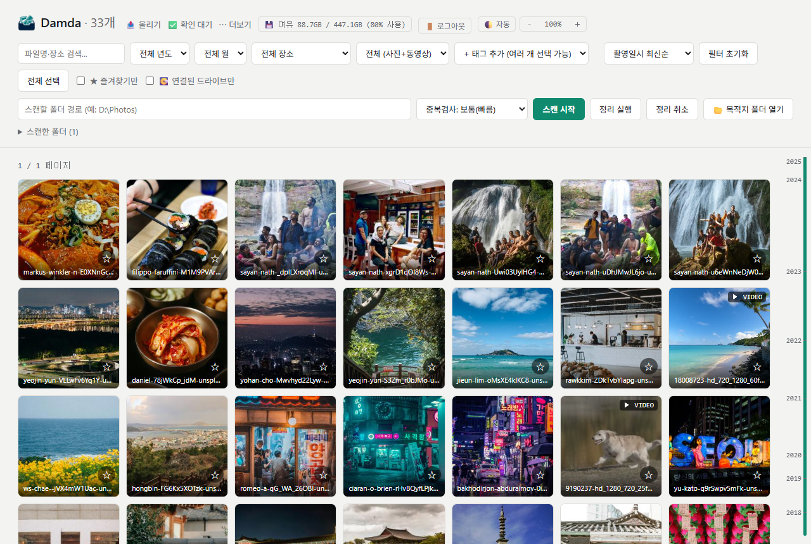
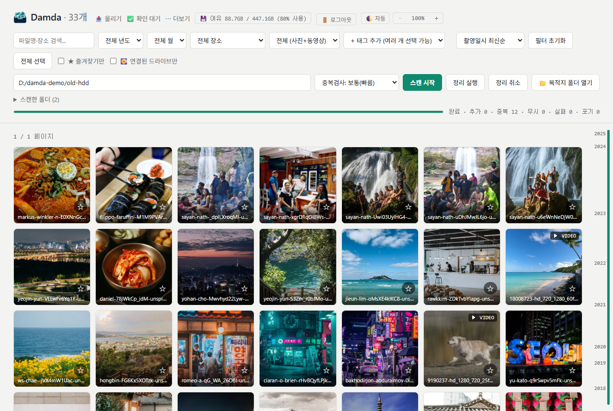
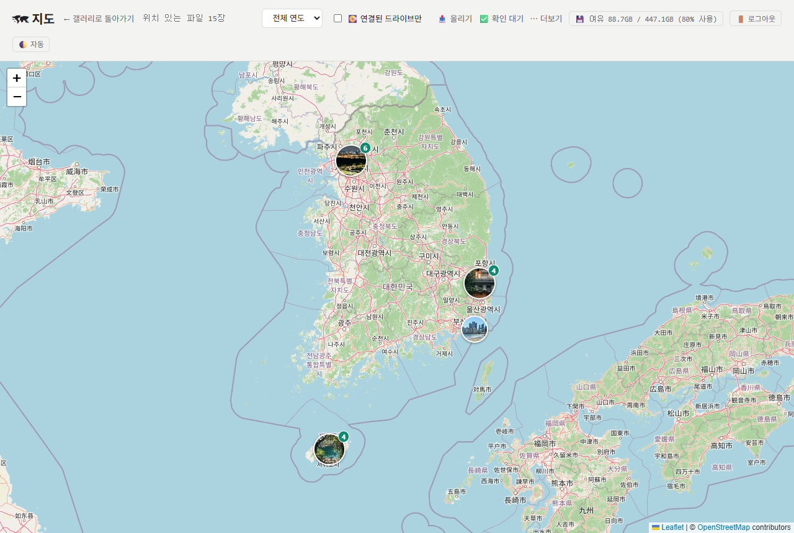
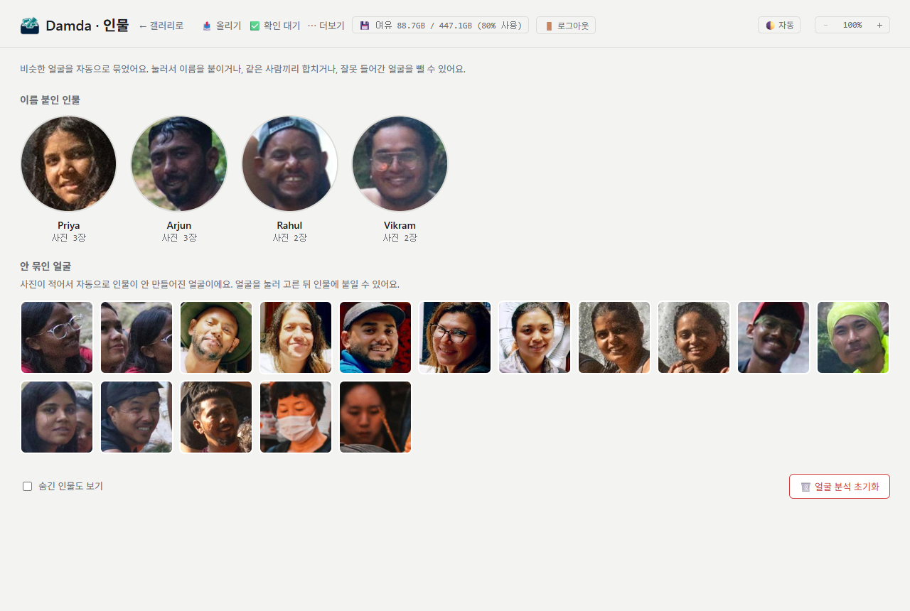
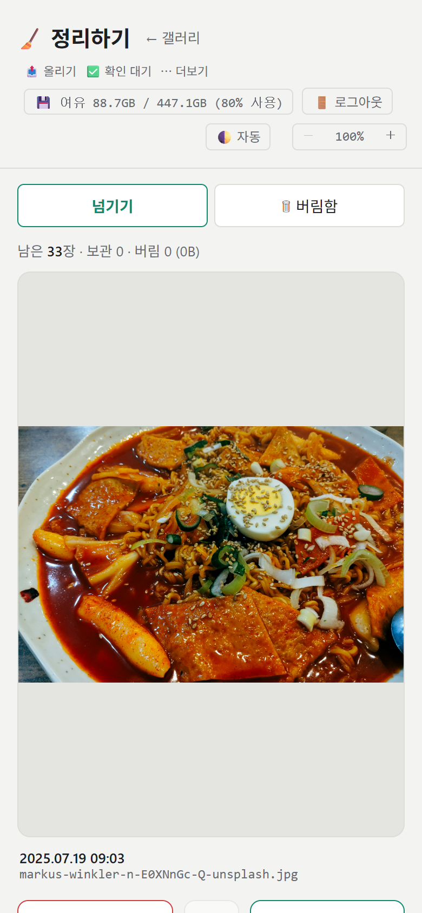

# Damda (담다)

**내 사진은 내 하드에.** 외장하드와 PC 여기저기 흩어진 사진·동영상을 한곳에 모아, 날짜별로 정리하고 다시 꺼내 보는 Windows 프로그램이에요.

클라우드에 올리지 않고 내 PC 안에서만 돌아가요. 허락 없이 사진을 지우거나 바꾸지 않아요.

## 이런 분께 좋아요

- 옛날 휴대폰·카메라 사진이 외장하드 몇 개에 뒤죽박죽 들어 있는 분
- 같은 사진이 여기저기 복사돼 있어서 용량만 차지하는 분
- 구글 포토 같은 클라우드에 사진을 맡기기 싫거나, 구독료가 부담되는 분

## 할 수 있는 것

### 📂 스캔하고 날짜별로 정리
폴더를 고르면 사진·동영상을 찾아서 똑같은 파일은 걸러내고, 촬영일 기준 `년/월` 폴더로 정리해요. 정리는 언제든 **되돌리기**로 원래 자리로 돌려놓을 수 있어요.

### 🖼️ 갤러리와 추억 보기
날짜·태그·검색으로 찾아보고, 동영상도 바로 재생해요. 앨범으로 묶어 슬라이드쇼로 보고, "몇 년 전 오늘"과 연간 리캡으로 잊고 있던 사진을 다시 만나요.

### 🗺️ 지도와 인물 `Pro`
사진을 찍은 장소를 지도에서 보고, 같은 사람이 나온 사진끼리 자동으로 묶어요.

### 📱 휴대폰 연동 `Pro`
QR코드를 찍으면 휴대폰으로 사진을 바로 올리고, 휴대폰에서 라이브러리를 보고, 스와이프로 정리할 수 있어요. Tailscale을 쓰면 밖에서도 접속돼요.

### 🛡️ 안심하고 쓰기
- 원본은 내가 지울 때만 지워져요. 동영상 자르기·용량 줄이기처럼 원본을 바꾸는 작업은 백업을 남기고 되돌릴 수 있어요.
- 태그·앨범·설정은 매일 자동으로 백업해요.
- 광고도, 데이터 수집도 없어요.

## 무료와 Pro

| 무료 | Pro |
|---|---|
| 스캔, 중복 거르기, 날짜별 정리와 되돌리기 | 휴대폰에서 올리기·보기·정리하기 |
| 갤러리, 검색, 태그, 앨범, 슬라이드쇼 | 밖에서 접속(Tailscale) |
| 동영상 재생·자르기·용량 줄이기 | 얼굴 분석(인물 묶기) |
| 추억 보기, 연간 리캡, 백업·복원 | 촬영 위치(지도, 장소로 찾기) |

처음 설치하면 **30일 동안 Pro를 무료로 체험**할 수 있어요. 체험이 끝나도 만들어 둔 인물 묶음과 지도는 그대로 보여요.

## 받기

**[Releases](../../releases/latest)** 에서 최신 `Damda-<버전>.exe` 를 받아 실행하세요.

- Windows 10/11 64비트
- 관리자 권한 없이 설치돼요 (프로그램: `%LOCALAPPDATA%\DamdaApp`, 데이터: `%LOCALAPPDATA%\Damda`)
- 새 버전이 나오면 앱이 알려줘요. 받은 설치 파일을 실행하면 덮어 설치되고, 사진·설정·계정은 그대로 남아요.
- 동영상 썸네일과 재생에는 FFmpeg가 필요해요. 앱의 설정 페이지에서 바로 설치할 수 있어요.

> **"Windows의 PC 보호" 창이 뜨면**
> 개인이 만든 프로그램이라 코드 서명이 없어서 뜨는 안내예요. **추가 정보 → 실행**을 누르면 설치돼요.

## Pro 구매

Damda는 무료로 쓸 수 있고, 아래 기능은 **Pro**에서 쓸 수 있어요. 처음 설치하면 **30일 동안 Pro를 무료로 체험**할 수 있어요.

- 📱 **휴대폰 연동**: 휴대폰으로 사진 올리기, 휴대폰에서 보기, 폰으로 정리하기, 밖에서 접속하기(Tailscale)
- 🙂 **얼굴 분석**: 같은 사람 사진끼리 자동으로 묶기
- 🗺️ **촬영 위치**: 지도에서 보기, 장소로 찾기

체험이 끝나도 지금까지 만든 인물 묶음과 지도는 그대로 보여요. 백업·복원·되돌리기 등 나머지 기능은 계속 무료예요.

### 가격

~~29,000원~~ → **출시 할인 19,900원 (2026년 12월 31일까지)** · 한 번 사면 계속 쓰는 영구 라이선스

- 인터넷 없이 확인되는 키라, 구매 후 서버가 꺼지거나 인터넷이 없어도 계속 쓸 수 있어요.
- PC에 묶이지 않아요. 새 PC로 옮겨도 같은 키를 다시 등록하면 돼요.

### 구매 방법

1. **ewndks@gmail.com** 로 "Damda Pro 구매" 메일을 보내 주세요. 라이선스에 표시할 이름(또는 이메일)을 같이 적어 주세요.
2. 답장으로 입금 방법을 안내해 드려요.
3. 입금이 확인되면 `DAMDA-`로 시작하는 라이선스 키를 메일로 보내 드려요.
4. Damda **설정 → 🔑 라이선스**에 키를 붙여넣고 **등록**을 누르면 끝이에요.

## 문의

버그나 바라는 기능은 [Issues](../../issues)에 남기거나 ewndks@gmail.com 으로 알려 주세요.

이 저장소는 설치 파일 배포용이에요.
